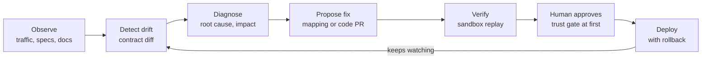

# Self-Maintaining APIs

Integrations rarely break because of bad code; they break because something on the other side changed. This project explores a product that closes the loop for APIs you consume but don't control: **detect → diagnose → repair → verify**.

Inspired by the "Self-maintaining APIs" request in Y Combinator's Fall 2026 Requests for Startups.

## Status

Early exploration: problem framing, product concepts, first-customer wedges, and validation plan.

## Contents

| Path | What's in it |
| --- | --- |
| [docs/brainstorm.md](docs/brainstorm.md) | Problem, product concepts, wedges, architecture loop, landscape, risks, next steps |

## The core loop

## Next steps

- [ ] Talk to 10 integration or platform leads about their last three breakages and what each cost
- [ ] Build a drift detector against 3 frequently changing public APIs
- [ ] Demo auto-repair: break a connector on purpose, show the PR that fixes it
- [ ] Line up 2 design partners
- [ ] Draft the YC one-liner and "why now"
