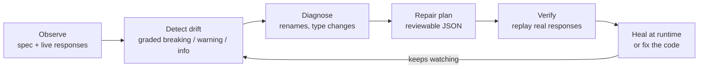

# apimend: self-maintaining APIs

[](https://github.com/milan6190/self-maintaining-apis/actions/workflows/ci.yml)
[](LICENSE)

Integrations rarely break because of bad code. They break because **something on the other side changed**: a field was renamed, a number became a string, a parameter became required. You find out when production does.

**apimend** watches the APIs you *consume but don't control* and closes the loop:



- **Detect**: compares OpenAPI/Swagger specs *and* real responses against a baseline. Every change is graded `breaking`, `warning` or `info`, using different rules for what you send and what you receive.
- **Diagnose**: recognizes renamed fields by name (`user_id` → `userId`, `email` → `emailAddress`) and by matching values. It also spots safe type changes (`"3"` vs `3`).
- **Repair**: writes a small, reviewable plan that turns the new response back into the shape your code expects.
- **Verify**: replays recorded responses through the plan and checks them against the baseline before you trust it.
- **Run anywhere**: a CLI, a Python library, and a GitHub Action. It's pure Python with one dependency (PyYAML) and has handled Stripe's 8 MB spec in under a second.

> Status: alpha (0.1). The core loop works and is tested; the plan format may still change.

## Quick start

```bash
pip install git+https://github.com/milan6190/self-maintaining-apis.git

apimend init            # writes apimend.yaml; point it at your APIs
apimend snapshot        # record today's spec and responses as the baseline
# ...days later...
apimend check           # what changed? exits 1 on breaking drift
apimend heal            # generate repair plans for what can be fixed automatically
apimend verify          # prove the plans restore the old shape on real responses
```

### Try the demo (no network needed)

```bash
git clone https://github.com/milan6190/self-maintaining-apis.git
cd self-maintaining-apis && pip install -e .
./examples/petstore/demo.sh
```

The demo takes a baseline of a Petstore API at v1, then checks it against v2 (renamed fields, a string-typed `age`, a removed field, a new required parameter, a removed endpoint). It heals what it can, flags what it can't, and runs unchanged v1 consumer code against v2 data.

## Configuration

```yaml
# apimend.yaml
store: .apimend            # baselines, current data, plans and reports
fail_on: breaking          # exit non-zero on: breaking | warning | never

apis:
  - name: billing
    spec: https://api.example.com/openapi.json      # URL or file, JSON or YAML, OpenAPI 3.x or Swagger 2.0
    headers:
      Authorization: "Bearer ${BILLING_TOKEN}"       # ${VAR} and ${VAR:-default} come from the environment
    endpoints:
      - name: list-invoices
        url: https://api.example.com/v1/invoices?limit=20
        headers:
          Authorization: "Bearer ${BILLING_TOKEN}"
      - name: webhook-payloads                       # or use recorded responses
        samples: ./captured/webhooks/*.json
```

You can use a spec, live endpoints, or both. Specs tell you what the provider *says* changed. Live responses tell you what *actually* changed, and they're what repair plans are built from. Commit `.apimend/baseline/` and `.apimend/plans/` so changes get reviewed like code.

## Commands

| Command | What it does |
| --- | --- |
| `apimend init` | Write a starter `apimend.yaml` |
| `apimend snapshot [api...]` | Record the baseline (`--append` adds more samples) |
| `apimend check [api...]` | Fetch current state, report drift (`--format json`, `-o file`, `--fail-on`, `--offline`, `-q`) |
| `apimend heal [api...]` | Write repair plans to `.apimend/plans/<api>/<endpoint>.json` |
| `apimend verify [api...]` | Replay current responses through plans and validate them |
| `apimend accept [api...]` | Adopt the current API as the new baseline once you've updated your code |
| `apimend diff OLD NEW` | Compare two spec files or URLs directly |
| `apimend infer FILE...` | Print the JSON Schema inferred from sample responses |
| `apimend propose API ENDPOINT --source FILE` | Ask Claude for a code fix (needs `ANTHROPIC_API_KEY`) |

Exit codes: `0` no drift at or above the threshold, `1` drift found (or verification failed), `2` configuration or fetch error.

## Healing in your code

```python
import requests
from apimend import Healer

heal = Healer.from_file(".apimend/plans/billing/list-invoices.json")
invoices = heal(requests.get(url, headers=headers).json())   # old shape, even after the provider changed
```

A plan is plain JSON that you can review in a pull request:

```json
{
  "version": 1,
  "api": "petstore",
  "endpoint": "list-pets",
  "ops": [
    {"op": "rename", "parent": "$[]", "from": "petName", "to": "name", "confidence": 0.95},
    {"op": "rename", "parent": "$[].owner", "from": "emailAddress", "to": "email", "confidence": 0.95},
    {"op": "coerce", "path": "$[].age", "from": "string", "to": "integer"},
    {"op": "default", "path": "$[].tag", "value": "unknown"}
  ],
  "unresolved": []
}
```

`rename` and `coerce` are generated for you. `default` and `drop` are for changes only a human can decide, like what a removed field should default to. They're kept when `apimend heal` regenerates the plan. See [docs/plans.md](docs/plans.md).

Healing is a bridge, not a destination: it keeps production running while you update the integration, then `apimend accept` moves the baseline forward.

## GitHub Action

```yaml
- uses: milan6190/self-maintaining-apis@main
  with:
    config: apimend.yaml
    fail-on: breaking     # optional
    heal: "true"          # optional: also write repair plans
```

The report is added to the job summary. The `breaking`, `warning` and `report` outputs let later steps open an issue or post to Slack. A complete nightly workflow that files an issue on breaking drift is in [examples/workflows/apimend-nightly.yml](examples/workflows/apimend-nightly.yml).

## What counts as breaking

| Change | In a response | In a request |
| --- | --- | --- |
| Field removed | 🔴 breaking | 🟡 warning |
| Field renamed (detected) | 🔴 breaking, auto-fixable from samples | 🔴 breaking |
| Field added | ⚪ info | 🔴 breaking if required, else ⚪ |
| Type changed incompatibly | 🔴 breaking (auto-fixable if values convert) | 🔴 breaking |
| Field can now be null | 🟡 warning | ⚪ info |
| New enum values | 🟡 warning (your switch statements) | ⚪ info |
| Enum values removed | ⚪ info | 🔴 breaking |
| Operation removed / required parameter added | 🔴 breaking | 🔴 breaking |

Shared schemas (`components.schemas`) are compared once and graded by where they're used: in requests, responses, or both (both takes the stricter result). The full rules are in [docs/how-it-works.md](docs/how-it-works.md).

## Limits (today)

- Rename detection is a heuristic. Every rename carries a confidence score and lands in a reviewable plan, never silently in production.
- Plans repair JSON response bodies. Request-side changes are reported, not rewritten.
- Live checks call `GET`-style endpoints you configure. Keep them read-only.
- Path keys containing `.` or `[` aren't supported in plans yet.

## Roadmap

- MCP server and agent-tool drift: keep agent tool definitions in sync with the APIs underneath
- Request-side healing (outgoing payload rewriting)
- Changelog and deprecation-notice monitoring
- Runtime proxy mode that heals traffic without code changes

The thinking behind the project is in [docs/brainstorm.md](docs/brainstorm.md).

## Contributing

Issues and pull requests are welcome. See [CONTRIBUTING.md](CONTRIBUTING.md).

## License

[MIT](LICENSE) © 2026 Milankumar Rana
