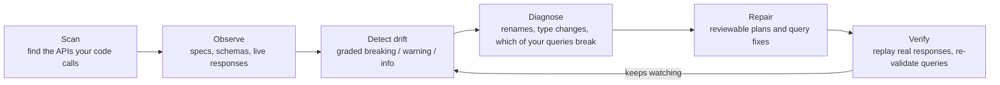

# apimend: self-maintaining APIs

[](https://github.com/milan6190/self-maintaining-apis/actions/workflows/ci.yml)
[](LICENSE)

Integrations rarely break because of bad code. They break because **something on the other side changed**: a field was renamed, a number became a string, a parameter became required. You find out when production does.

**apimend** finds the APIs your code depends on, watches them, and closes the loop when they change:



- **Scan:** one command reads your repo (code, config, specs, GraphQL operations, Postman collections, dependencies) and writes the config. It knows where well-known providers publish their specs, so APIs like Stripe and GitHub need no setup at all.
- **REST:** compares OpenAPI 3.x and Swagger 2.0 specs (single or multi-file) and real JSON responses against a baseline.
- **GraphQL:** compares schemas (SDL, introspection JSON, or a live endpoint) and checks **the queries your code actually sends** against them, so you see which of your operations a change breaks.
- **Repair:** renamed response fields are mapped back at runtime. Renamed GraphQL fields are fixed with aliases, so your code reads the same keys.
- **Verify:** proves a repair works by replaying recorded responses and re-validating every query.
- **Runs anywhere:** a CLI, a Python library, and a GitHub Action. It's pure Python with one dependency (PyYAML).

> Status: alpha (0.2). The core loop is tested against real APIs (see [Tested on real APIs](#tested-on-real-apis)); config and plan formats may still change.

## Quick start

```bash
pip install git+https://github.com/milan6190/self-maintaining-apis.git

cd your-repo
apimend scan        # finds the APIs your code uses and writes apimend.yaml
apimend snapshot    # records today's specs, schemas and responses as the baseline
apimend check       # later, or in CI: what changed? exits 1 on breaking drift
```

What `apimend scan` prints for a typical app:

```
API                    Type     Found via                         Watch with             Status
---------------------  -------  --------------------------------  ---------------------  -----------
acme                   openapi  spec, config                      spec                   ready
github-graphql         graphql  registry, dependency, operations  spec + 1 operation(s)  ready
slack                  openapi  registry, dependency              spec                   ready
stripe                 openapi  registry, dependency              spec                   ready
acme-graphql           graphql  config, operations                introspection          needs setup
billing-internal-acme  rest     code, config                      1 live endpoint(s)     needs setup

Wrote apimend.yaml: 4 API(s) ready, 2 need a step noted in the file.
```

**Ready** APIs work immediately: their spec comes from your repo or from the provider's public repository. The others are written as commented-out entries that say what's missing, usually an auth header for a live endpoint. Scan never calls your APIs; `--enable-live` turns the live entries on. [How scanning works →](docs/scan.md)

### Try the demos (no network needed)

```bash
git clone https://github.com/milan6190/self-maintaining-apis.git
cd self-maintaining-apis && pip install -e .
./examples/petstore/demo.sh        # REST: renamed fields, a string-typed number, a removed field
./examples/graphql-shop/demo.sh    # GraphQL: which of your queries break, and alias-based fixes
cd examples/scan-demo/acme-app && apimend scan --print   # scanning a sample company repo
```

## Rolling it out across a company

**Per repository:** run `apimend scan`, review `apimend.yaml`, run `apimend snapshot`, and commit `apimend.yaml` plus `.apimend/baseline/`. Then add the GitHub Action (below) so every pull request and a nightly job check for drift. Large specs are stored compressed (Stripe's 8 MB spec becomes about 0.5 MB).

**Org-wide inventory:** scan many repos at once and get JSON you can load into a spreadsheet or dashboard:

```bash
gh repo list YOUR-ORG --limit 500 --json name -q '.[].name' |
  xargs -I{} gh repo clone YOUR-ORG/{} repos/{} -- --depth 1
apimend scan repos/* --format json > api-inventory.json
```

Each entry lists the API, how it was found (code, config, spec, dependency, Postman, GraphQL operations), the files and lines as evidence, and whether it can be watched today.

## GraphQL

Point apimend at a schema and at the operations your app sends:

```yaml
apis:
  - name: shop
    graphql: https://api.shop.example/graphql   # live introspection, or `spec: schema.graphql`
    headers:
      Authorization: "Bearer ${SHOP_TOKEN}"
    operations:
      - src/**/*.graphql
      - src/**/*.ts            # gql`...` and graphql(`...`) templates are found too
      - "!**/*.test.*"         # leave out tests
```

`apimend check` then reports schema changes, marked with the operations they affect, and every operation the new schema breaks:

```
| 🔴 | graphql schema                      | `User.email` was removed; it appears to be renamed to `emailAddress` · used by query GetUser | yes |
| 🔴 | query GetUser (src/user.graphql:4)  | cannot query field `email` on type `User`.                                                    | yes |
| 🟡 | query GetUser (src/user.graphql:5)  | `User.username` is deprecated: Use `handle`; removed after 2027-01-01.                        |     |
```

`apimend heal` repairs renames with aliases, so the response keeps its shape and your code needs no change:

```diff
-    email
+    email: emailAddress
```

Review the generated `.patch`, then `apimend heal --apply` edits your files and `apimend verify` re-validates every operation. Set `only_used: true` to report only schema changes your operations touch. [GraphQL details →](docs/graphql.md)

## Configuration

```yaml
# apimend.yaml
store: .apimend            # baselines, current data, plans and reports
fail_on: breaking          # exit non-zero on: breaking | warning | never

apis:
  - name: billing
    spec: https://api.example.com/openapi.json      # OpenAPI, Swagger or GraphQL; URL or file; multi-file specs OK
    headers:
      Authorization: "Bearer ${BILLING_TOKEN}"       # ${VAR} and ${VAR:-default} come from the environment
    endpoints:
      - name: list-invoices                          # live GET calls whose real responses are compared
        url: https://api.example.com/v1/invoices?limit=20
        headers:
          Authorization: "Bearer ${BILLING_TOKEN}"
      - name: webhook-payloads                       # or recorded responses
        samples: ./captured/webhooks/*.json

  - name: catalog
    graphql: https://api.example.com/graphql        # schema by introspection
    operations: [src/**/*.graphql]
    only_used: true
    endpoints:
      - name: featured                               # a live GraphQL query
        query: "{ featured { id title price } }"
```

Specs say what the provider *documents*; live responses show what it *actually returns*, and they're what response repair plans are built from. Commit `.apimend/baseline/` and `.apimend/plans/` so changes are reviewed like code.

## Commands

| Command | What it does |
| --- | --- |
| `apimend scan [paths...]` | Find the APIs your code uses and write `apimend.yaml` (`--print`, `--format json`, `--enable-live`, `--snapshot`, `--force`) |
| `apimend snapshot [api...]` | Record the baseline (`--append` adds more samples) |
| `apimend check [api...]` | Fetch the current state and report drift (`--format json`, `-o file`, `--fail-on`, `--offline`, `-q`) |
| `apimend heal [api...]` | Write response repair plans and GraphQL query fixes (`--apply` edits your query files) |
| `apimend verify [api...]` | Replay responses through plans; re-validate GraphQL operations |
| `apimend accept [api...]` | Adopt the current API as the new baseline once your code is updated |
| `apimend diff OLD NEW` | Compare two specs or schemas directly (`--operations GLOB` for GraphQL) |
| `apimend init` | Write a commented starter config by hand |
| `apimend infer FILE...` | Print the JSON Schema inferred from sample responses |
| `apimend propose API ENDPOINT --source FILE` | Ask Claude for a code fix (needs `ANTHROPIC_API_KEY`) |

Exit codes: `0` no drift at or above the threshold, `1` drift found (or verification failed), `2` configuration or fetch error.

## Healing REST responses in code

```python
import requests
from apimend import Healer

heal = Healer.from_file(".apimend/plans/billing/list-invoices.json")
invoices = heal(requests.get(url, headers=headers).json())   # old shape, even after the provider changed
```

A plan is plain JSON that you review in a pull request: `rename` and `coerce` ops are generated; `default` and `drop` are for decisions only a human can make, and survive regeneration. See [docs/plans.md](docs/plans.md). Healing is a bridge, not a destination: it keeps production running while you update the integration, then `apimend accept` moves the baseline forward.

## GitHub Action

```yaml
- uses: milan6190/self-maintaining-apis@main
  with:
    config: apimend.yaml
    fail-on: breaking     # optional
    heal: "true"          # optional: also write repair plans
```

The report is added to the job summary. The `breaking`, `warning` and `report` outputs let later steps open an issue or post to Slack. A nightly workflow that files an issue on breaking drift is in [examples/workflows/apimend-nightly.yml](examples/workflows/apimend-nightly.yml).

## What counts as breaking

**REST** (responses are what you read, requests what you send):

| Change | In a response | In a request |
| --- | --- | --- |
| Field removed | 🔴 breaking | 🟡 warning |
| Field renamed (detected) | 🔴 breaking, auto-fixable from samples | 🔴 breaking |
| Field added | ⚪ info | 🔴 breaking if required, else ⚪ |
| Type changed incompatibly | 🔴 breaking (auto-fixable if values convert) | 🔴 breaking |
| Field can now be null | 🟡 warning | ⚪ info |
| New enum values / union variants | 🟡 warning | ⚪ info |
| Enum values / union variants removed | ⚪ info | 🔴 breaking |
| Operation removed / required parameter added | 🔴 breaking | 🔴 breaking |

**GraphQL** follows the reference implementation's rules (`findBreakingChanges` / `findDangerousChanges`), plus: a removed field that looks renamed is reported as a rename, and new deprecations are warnings, because they usually come before a removal. Any operation of yours that stops validating is breaking.

The full rules are in [docs/how-it-works.md](docs/how-it-works.md).

## Tested on real APIs

- **Specs from seven providers** load and diff across their real git history: Stripe, GitHub REST, GitHub GraphQL, Twilio, OpenAI (OpenAPI 3.1), Slack (Swagger 2.0) and Box. Stripe's 8 MB spec diffs in about a second.
- **Multi-file specs:** DigitalOcean's public API (858 operations across 3,520 files) is bundled and compared.
- **GraphQL correctness:** schema parsing matches the reference implementation (graphql-core) exactly on GitHub's 1.2 MB schema. Breaking-change counts match `findBreakingChanges` on real GitHub schema history, and query validation matches the reference validator on every test case.
- **Real consumer code:** in Shopify's Hydrogen repo, scan matched 114 operations to the right one of two schemas, and all validate. Across Shopify's real 2026-10 API upgrade, 113 schema changes were narrowed to the 13 that touch Hydrogen's queries. The one breaking change among them, `CustomerAddressInput.territoryCode` leaving the schema, is the one Hydrogen's maintainers replaced with `countryCode` in that same upgrade.
- **Scan precision:** on Stripe's sample app it finds exactly Stripe; on LangChain (3,275 files) exactly the nine external services the code talks to, with no fixtures, docs links or test hosts.

## Limits (today)

- Rename detection is a heuristic. Every rename carries a confidence score and lands in a reviewable plan or patch, never silently in production.
- REST plans repair JSON response bodies; request-side changes are reported, not rewritten. GraphQL fixes rewrite field and argument names in your queries.
- Scan finds URLs written in code and config; URLs assembled entirely at runtime (`f"{BASE}/{path}"` with `BASE` from a secret store) are found only through their base-URL settings.
- Live checks call the `GET` endpoints you configure. Keep them read-only.
- GraphQL subscriptions are validated but not executed. Plans don't support path keys containing `.` or `[`.

## Roadmap

- MCP server and agent-tool drift: keep agent tool definitions in sync with the APIs underneath
- More providers in the scan registry (contributions welcome: [src/apimend/registry.py](src/apimend/registry.py))
- Request-side healing (rewriting outgoing payloads)
- Changelog and deprecation-notice monitoring
- A runtime proxy that heals traffic without code changes

The thinking behind the project is in [docs/brainstorm.md](docs/brainstorm.md).

## Contributing

Issues and pull requests are welcome. See [CONTRIBUTING.md](CONTRIBUTING.md). The most useful contributions are real-world drift cases that apimend misses or misgrades, and scan false positives with the line that caused them.

## License

[MIT](LICENSE) © 2026 Milankumar Rana
