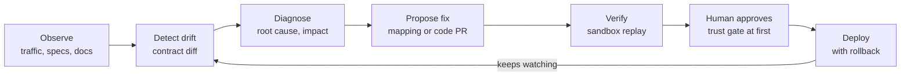

# Self-Maintaining APIs — Brainstorm

Oct 28, 2026 · Milan

## The problem

Integrations rarely break because of bad code; they break because something on the other side changed. Every enterprise team owns dozens to hundreds of connectors, and keeping them alive is ongoing, invisible toil.

Common causes of breakage:

- **Schema drift**: a partner renames a field, changes a type, or nests a payload differently.
- **Version deprecation**: v2 is sunset, and the migration guide is a changelog nobody read.
- **Auth changes**: OAuth scopes, token lifetimes, or key rotation policies shift.
- **Behavioral drift**: same schema, different semantics (new enum values, pagination changes, rate limits).
- **Internal API sprawl**: microservices change contracts faster than consumers can track.

Why it matters now: AI agents are becoming API consumers. An agent calling 40 tools fails silently when one tool's contract shifts, and nobody is paged until a business process quietly breaks.

Open question: what does a broken integration cost a typical mid-size enterprise per incident (engineer hours, SLA penalties, lost data)? Worth sizing with real customer conversations.

## Product concepts

Five ways to interpret "self-maintaining," from narrowest wedge to broadest platform. They can stack: start at 1 or 2, expand to 4 or 5.

| # | Concept | What it does | Who feels the pain | Scope |
| --- | --- | --- | --- | --- |
| 1 | Drift detector | Watches live traffic and partner docs, flags contract changes before they break prod | Integration and platform teams | Narrow wedge |
| 2 | Auto-repairing connectors | Detects a break, proposes a mapping or code fix as a PR, validates in a sandbox | Teams with 50+ third-party integrations | Core product |
| 3 | Migration autopilot | Reads a deprecation notice, generates the v1→v2 migration across every call site | Any team facing a forced upgrade | Event-driven wedge |
| 4 | Self-healing API gateway | Runtime layer that translates between old and new contracts on the fly while the fix ships | Enterprises with internal API sprawl | Platform |
| 5 | Agent tool registry | Keeps MCP servers and agent tool definitions in sync with the APIs underneath | Teams deploying AI agents | Future-facing |

Strongest instinct to test: **2 + 5**. Auto-repair is the clearest "I'd pay for that" moment, and agent tooling gives the YC-native narrative.

## Who buys first

The best first customer has many integrations, a painful history of breakage, and a budget owner who gets blamed when things go down.

| Wedge | Buyer | Why they'd pay | Watch out for |
| --- | --- | --- | --- |
| Logistics and supply chain | VP Integration / EDI lead | Hundreds of carrier, 3PL, and customs APIs; breakage stops shipments | Long sales cycles, legacy EDI formats |
| Fintech and payments | Head of Platform | Bank and processor APIs change often; downtime is regulatory risk | Security reviews, compliance gating |
| Unified-API companies | CTO | Their whole product is maintaining connectors; this is their cost center | They may build it in-house |
| Systems integrators and consultancies | Delivery lead | Maintenance contracts eat margin after go-live | Fragmented buying, per-project budgets |
| Teams shipping AI agents | AI platform lead | Tool calls fail silently; no one owns tool health | Market is early and shifting fast |

Leaning toward logistics or unified-API companies first: concentrated pain, measurable cost per outage, and a short list of names to call.

## How it works

The core product is a closed loop: observe the APIs you consume, detect contract drift, diagnose impact, and propose a fix as a PR that is replayed in a sandbox before a human approves it. After deploy, monitoring feeds straight back into detection. Proposing the fix is the moat; detection alone is a feature others can copy.

## Landscape

Plenty of tools help you build or test integrations; few take ownership of keeping them alive after launch. That ownership gap is the opening. (Drawn from general knowledge, not yet researched; verify before relying on it.)

| Category | Examples | What they do | Gap |
| --- | --- | --- | --- |
| Unified APIs | Merge, Apideck | One API over many SaaS apps in a category | They maintain connectors by hand; you're locked to their coverage |
| Integration infrastructure | Nango, Paragon | Auth, sync, and hosting for your own connectors | Still your code to fix when partners change |
| SDK generation | Speakeasy, Stainless, Fern | Generate SDKs from OpenAPI specs | Producer-side; doesn't help consumers of APIs you don't own |
| Contract testing | Pact, Postman | Catch contract breaks in CI | Detects, doesn't repair; needs both sides to participate |
| iPaaS | MuleSoft, Boomi, Workato | Enterprise integration platforms | Heavy, expensive; repairs still manual |

The gap: nobody closes the loop from **detect → diagnose → repair → verify** for APIs you consume but don't control.

## Unfair advantages and risks

**Founder-market fit to lean on**

- Years of enterprise integration and platform work at Fortune 500 scale, including a logistics giant with heavy carrier and partner integrations.
- Multi-cloud architecture depth (Azure, GCP, Databricks) for running this inside customer VPCs, which security teams will demand.
- Existing consulting relationships that can become design partners.
- Patents and published research for credibility in an enterprise sale.

**Risks**

- **Trust**: will anyone let an agent push a fix to production? Likely start with "propose a PR, human approves."
- **Correctness**: a wrong auto-repair is worse than a loud failure. Needs strong verification and rollback.
- **Incumbent response**: Postman, MuleSoft, or a unified-API player could add an "AI fix" feature.
- **Data access**: repair needs real traffic samples, which means PII and compliance work early.
- **Crowding**: agent-tooling space is busy; positioning must be about reliability, not "agents."
- **Founder setup**: YC strongly favors a cofounder and full-time commitment.

## Open questions and next steps

**Questions to answer**

- Which wedge has the highest cost per broken integration?
- Detection-only first, or straight to repair?
- Sell as SaaS, or deploy into the customer's cloud?
- Pricing unit: per connector, per API call, or per incident prevented?
- Solo, or find a cofounder (go-to-market or ML)?

**Validation steps**

- [ ] Talk to 10 integration or platform leads; ask about their last three breakages and what each cost
- [ ] Pick 3 public APIs with frequent changes and build a drift detector against their specs and changelogs
- [ ] Demo auto-repair: break a connector on purpose, show the PR that fixes it
- [ ] Line up 2 design partners from existing relationships
- [ ] Draft the YC application one-liner and the "why now" answer
